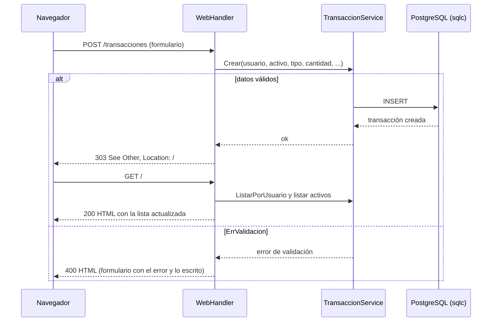
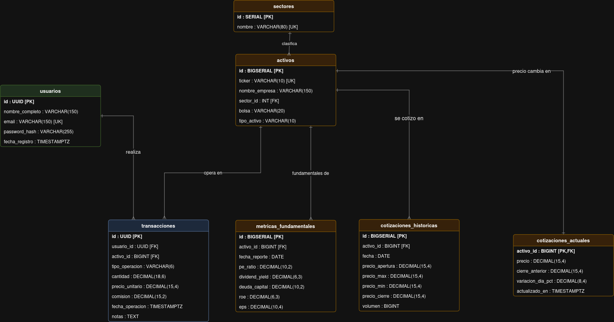

# ProgramacionWebTP — GoFolio

**Dominio elegido:** GoFolio, una aplicación web para registrar transacciones y gestionar un portafolio de inversiones financieras.

**Integrantes:** Franco Ramallo, Jeronimo Pourtau Fleischmacher,Juan Bautista, Galvan

| TP | Qué se construyó |
|---|---|
| TP2 | Modelo de datos en PostgreSQL y acceso a datos con `sqlc` |
| TP3 | API REST (JSON) con `net/http`, capas handlers → services → sqlc (rama `tp3`) |
| TP4 | Frontend con HTML + JavaScript que consumía la API |
| **TP5** | **Interfaz renderizada en el servidor con [templ](https://templ.guide), sin JavaScript** (rama `tp5`) |

## Qué hace la aplicación (TP5)

Una página única donde el usuario administra las operaciones (compras y ventas) de su portafolio:

* **Historial de operaciones:** fecha, activo, tipo, cantidad, precio, comisión y notas.
* **Registrar una operación:** formulario con activo, tipo, cantidad, precio, comisión y notas opcionales. Si los datos no son válidos, la página se vuelve a mostrar con el mensaje de error y lo que el usuario había escrito.
* **Borrar una operación** desde el historial.

El servidor genera el HTML con **templ** y los estilos usan **Pico.css**. No hay JavaScript: formularios y botones son HTML común y cada acción recarga la página completa.

---

## Cómo ejecutar (TP5)

**Requisitos:** Go 1.24 o superior, Docker con Docker Compose v2 (`docker compose`), `make` e internet
(imágenes de Docker, módulos de Go y Pico.css por CDN). No hace falta instalar `sqlc` ni `templ`.

```bash
git clone -b tp5 --single-branch https://github.com/FranRamallo/ProgramacionWebTP.git
cd ProgramacionWebTP/TP3_DB
make run-app            # equivalente: bash run-app.sh
```

Cuando aparezca `Servidor corriendo en http://localhost:8080`, abrí esa dirección en el navegador.
Para detener la aplicación: `Ctrl+C` (limpia todo solo). La primera ejecución tarda más porque descarga
imágenes y módulos.

### Qué hace `run-app.sh`

| Fase | Pasos |
|---|---|
| **1. Tareas previas** | `templ generate` (vistas) → `sqlc generate` (acceso a datos; si `sqlc` no está instalado se ejecuta con `go run`) → compilar a `bin/gofolio` → borrar contenedores y volúmenes viejos → `docker compose up -d --wait` (levanta PostgreSQL y espera a que esté listo) |
| **2. Ejecución** | Inicia la aplicación en primer plano |
| **3. Tareas posteriores** | Siempre al salir (`Ctrl+C`, error o `kill`): detiene la app, borra `bin/` y ejecuta `docker compose down -v` (contenedores y volúmenes) |

La base se crea desde cero en cada ejecución con `db/schema/schema.sql` y los datos de ejemplo de
`db/seed/seed.sql` (5 activos y 5 operaciones de un usuario demo), así que el historial nunca arranca vacío.

El código generado (`db/sqlc/*.go` y `views/*_templ.go`) **no se sube al repositorio**: lo produce
`run-app.sh` en cada ejecución. En un clon recién hecho, el editor marca errores en esas carpetas hasta
correr `make run-app` o `make generate`.

### Configuración (opcional)

Sin configurar nada funciona. Para cambiar un valor, exportalo antes de ejecutar
(por ejemplo `DB_PORT=5433 make run-app`):

| Variable | Por defecto | Uso |
|---|---|---|
| `DB_USER` / `DB_PASSWORD` / `DB_NAME` | `postgres` / `postgres` / `apirest` | Credenciales de PostgreSQL |
| `DB_HOST` / `DB_PORT` | `localhost` / `7777` | Dónde escucha PostgreSQL (puerto publicado por Docker) |
| `PORT` | `8080` | Puerto HTTP de la aplicación |

### Otros comandos

| Comando | Qué hace |
|---|---|
| `make generate` | Regenera las vistas (`templ`) y el código de `sqlc` |
| `make db-up` / `make db-down` | Levanta / elimina solo la base de datos (para desarrollar con `go run ./cmd/api`) |
| `make test` | Pruebas HTTP de las páginas (Hurl) + tests de la base de datos (ver [Pruebas](#pruebas)) |

---

## Cómo funciona (renderizado del lado del servidor)

El navegador pide páginas y el servidor responde **HTML ya armado**.

| Método | Ruta | Qué hace | Respuesta |
|---|---|---|---|
| `GET` | `/` | Lista las transacciones y muestra el formulario de alta | `200` HTML |
| `POST` | `/transacciones` | Registra una operación | `303` → `/` si salió bien; `400` + la misma página con el error y lo escrito si no |
| `POST` | `/transacciones/eliminar` | Borra una operación (el `id` viaja en un campo oculto) | `303` → `/` (`400` si el id no es un UUID) |
| `GET` | `/static/…` | Archivos estáticos (`styles.css`) | CSS |
| `GET` | `/ping` | Chequeo de salud | `ok` |

Cualquier otra ruta responde `404`, y un método no permitido sobre una ruta existente, `405` (lo resuelve
`http.ServeMux` de Go ≥ 1.22 con patrones `"MÉTODO /ruta"`).

### Flujo de alta: Post/Redirect/Get

Después de un `POST` exitoso el servidor no devuelve HTML sino `303 See Other` con `Location: /`. El
navegador hace un `GET /` por su cuenta y muestra la lista actualizada; así, recargar la página (F5) no
reenvía el formulario ni duplica la operación.



---

## Arquitectura

Se mantiene el modelo de **3 capas**: `handlers → services → sqlc → PostgreSQL`.

| Capa | Dónde | Responsabilidad | Qué NO hace |
|---|---|---|---|
| Presentación | `views/` (templ), `internal/handlers/`, rutas en `cmd/api/main.go` | Recibir el request, parsear el formulario, pedir datos a los servicios, elegir el status HTTP (200/303/400/500) y dibujar el HTML | Reglas de negocio ni SQL |
| Lógica de negocio | `internal/services/` | Validaciones de dominio (tipo `compra`/`venta`, cantidad > 0, montos, notas, FK inexistente), limpieza de datos, traducción de errores de PostgreSQL | Saber qué es un request HTTP ni escribir SQL |
| Datos | `db/queries/queries.sql` → `sqlc` → `db/sqlc/` | Ejecutar consultas y mapear filas a structs Go | Tomar decisiones de negocio |

En el TP5 solo cambió la capa de presentación (de API JSON + JavaScript a vistas templ): servicios y
acceso a datos se reutilizaron sin modificaciones, que es justamente lo que busca el modelo de 3 capas.

### Vistas templ

| Componente | Archivo | Recibe | Dibuja |
|---|---|---|---|
| `Layout(titulo)` | `layout.templ` | título + `{ children... }` | `<html>`, `<head>` (Pico.css + `styles.css`), `<body>` |
| `TransaccionForm(activos, valores, error)` | `transaccion_form.templ` | activos, valores escritos, mensaje | Formulario `POST /transacciones` |
| `TransaccionList(transacciones, activos)` | `transaccion_list.templ` | transacciones + activos (para mostrar el ticker) | Tabla; un mini-formulario `POST` de borrado por fila |
| `IndexPage(datos)` | `index.templ` | `IndexData` | `Layout` + formulario + lista |

`templ generate` convierte cada `.templ` en `*_templ.go` (Go normal, tipado y con escape automático de
HTML). El binario final no necesita templ instalado.

### Estructura de `TP3_DB/`

```
TP3_DB/
├── cmd/api/main.go                  # arma dependencias y rutas, levanta el servidor
├── views/                           # presentación (templ)
│   ├── layout.templ                 # <html>, <head> con Pico.css, <body>
│   ├── transaccion_form.templ       # formulario de alta
│   ├── transaccion_list.templ       # tabla con el historial
│   ├── index.templ                  # IndexPage: layout + formulario + lista
│   └── helpers.go                   # formateo de fechas y decimales (solo presentación)
├── internal/
│   ├── handlers/web_handler.go      # Index, Crear, Eliminar (HTTP ↔ servicios)
│   ├── services/                    # lógica de negocio por entidad
│   └── middleware/                  # logging de requests
├── db/
│   ├── schema/schema.sql            # tablas
│   ├── seed/seed.sql                # datos de ejemplo (usuario demo, activos, operaciones)
│   ├── queries/queries.sql          # consultas SQL (entrada de sqlc)
│   └── sqlc/                        # código generado por sqlc (no se versiona) + db_test.go
├── static/styles.css                # estilos propios (se cargan después de Pico.css)
├── tests/web.hurl                   # pruebas HTTP de las páginas
├── docker-compose.yml               # PostgreSQL 15
├── run-app.sh · test.sh · Makefile
└── sqlc.yaml
```

---

## Decisiones de diseño (TP5)

* **Sin JavaScript.** Todo es HTML + CSS. Un navegador solo sabe enviar formularios con `GET` o `POST`, por eso el borrado es un `POST` con el `id` en un campo oculto y no un `DELETE`.
* **Un handler por pantalla, un servicio por entidad.** `WebHandler` agrupa lo que pasa en la página principal y combina los servicios que necesita (transacciones y activos); cada servicio mantiene la lógica de una sola entidad.
* **Validación en el borde, una sola vez.** El handler valida el *formato* de lo que llega (que el activo sea un número, que el `id` sea un UUID) y el servicio valida las *reglas de negocio* (cantidad mayor a 0, tipo permitido, activo existente, largo de las notas).
* **Errores de validación:** se vuelve a dibujar la página con status `400`, el mensaje y los valores escritos (en vez de redirigir y perderlos). Los errores inesperados se registran en el log y responden `500` sin mostrar detalles internos.
* **Borrado tolerante:** si la operación ya no existe (doble clic o pestaña desactualizada) se vuelve a `/` igual, sin error. El `DELETE` filtra por `id` **y** `usuario_id`, así que un usuario nunca puede borrar operaciones ajenas aunque cambie el `id` en el formulario.
* **Notas opcionales, máximo 200 caracteres.** La columna `notas` es `TEXT` (sin tope), así que el límite se valida en el servicio (el `maxlength` del formulario es solo comodidad). En el historial se muestran en una línea bajo el ticker, cortadas con "…", y completas al pasar el mouse (`title`).
* **Usuario demo fijo:** sin login, `main.go` le pasa al handler el `usuarioID` del usuario creado por `db/seed/seed.sql`. Cuando se implementen sesiones se reemplaza por el usuario autenticado y habrá que agregar protección CSRF a los formularios.
* **Pico.css por CDN** (versión fija `2.1.1`) + `static/styles.css` para el layout de dos columnas y los colores de compra/venta.
* **Seed en el arranque de la BD:** `docker-compose.yml` monta `01-schema.sql` y `02-seed.sql` en `docker-entrypoint-initdb.d` (Postgres los corre en orden, solo con el volumen vacío; por eso `run-app.sh` borra el volumen antes de levantar). El `healthcheck` usa `pg_isready -h 127.0.0.1` (TCP) para no declarar "listo" antes de que la base acepte conexiones de la app.
* **Código generado fuera del repositorio:** `db/sqlc/*.go` y `views/*_templ.go` están en `.gitignore` y los produce `run-app.sh` en cada ejecución. Los tests de `db/sqlc` (`*_test.go`) sí se versionan.
* **Herramientas fijadas en `go.mod`:** `templ` se ejecuta con `go tool templ`, así la versión del generador coincide siempre con la de la librería que usa el código generado. `sqlc` usa la versión instalada o, si no hay, `go run` con una versión fija.

### Cambios respecto del TP4

| Antes (TP4) | Ahora (TP5) |
|---|---|
| `index.html` + `app.js` consumían la API con `fetch` | Vistas templ renderizadas en el servidor |
| Handlers JSON por entidad (`/sectores`, `/activos`, `/transacciones`, …) | `WebHandler` con rutas de página |
| Tests de la API JSON con Hurl (`requests.hurl`) | Pruebas HTTP de las páginas (`tests/web.hurl`) |
| `test.sh` único | `run-app.sh` (ejecutar) y `test.sh` (probar) |

---

## Pruebas

```bash
make test
```

Hace lo mismo que `run-app.sh` (generar, compilar, base nueva, app en segundo plano) y ejecuta:

* **`tests/web.hurl`:** 13 peticiones HTTP contra las páginas: principal con los datos del seed, archivos estáticos, alta válida con redirect `303`, validaciones `400` (cantidad inválida, activo inválido), borrado (incluido el doble borrado y el id inválido), `404` y `405`.
* **`go test -count=1 ./...`:** los tests de la capa de datos (`db/sqlc`), que ejecutan el CRUD de las 7 entidades. `-count=1` desactiva la caché de Go, porque los resultados dependen de la base. Estos tests se conectan siempre a `localhost:7777` con las credenciales por defecto.

Al terminar limpia todo (app, `bin/`, contenedores y volúmenes), aunque algo falle.
Requiere [Hurl](https://hurl.dev): `brew install hurl` (macOS), `pacman -S hurl` (Arch), o el paquete
`.deb` desde [Hurl Releases](https://github.com/Orange-OpenSource/hurl/releases) (Ubuntu/Debian).

---

## Entidades principales del dominio

* **Usuarios:** Datos de la cuenta del inversor (ID, email, credenciales).
* **Activos:** Catálogo de instrumentos financieros operables (Ticker, nombre, tipo).
* **Sectores:** Clasificación de la industria para analizar la diversificación del portafolio (ej: Tecnología, Finanzas).
* **Transacciones:** Registro de compras y ventas (usuario, activo, cantidad, precio, fecha, tipo).
* **Cotizaciones Actuales:** Último precio de mercado conocido por cada activo.
* **Cotizaciones Históricas:** Serie de precios diarios (apertura, máximo, mínimo, cierre, volumen) para graficar rendimientos.
* **Métricas Fundamentales:** Datos financieros trimestrales de las empresas (P/E Ratio, Dividend Yield, ROE, EPS, Deuda/Capital) para análisis.



> En el TP5 la interfaz trabaja con la entidad **Transacciones** (listar, registrar y borrar); el resto del
> modelo sigue disponible en la base y en los servicios.

## Modelo de datos (Persistencia - TP2)

La capa de persistencia está construida sobre **PostgreSQL 15** y se diseñó priorizando la integridad de los datos financieros y el rendimiento de lectura.

### 1. Esquema relacional
* `usuario`: Entidad principal de autenticación y dueña de los portafolios.
* `sector` y `activo`: Tablas de catálogo estático. Un sector agrupa múltiples activos (Relación 1:N).
* `transaccion`: Tabla transaccional central. Vincula a un `usuario` con un `activo` (Relación N:M).
* `cotizacion_actual`, `cotizacion_historica` y `metrica_fundamental`: Tablas satélite de mercado, fuertemente ligadas a la entidad `activo` mediante Foreign Keys.

### 2. Decisiones de diseño de base de datos
* **Tipos de datos financieros:** Se descartó el uso de coma flotante (`FLOAT`/`REAL`) por sus problemas de redondeo. En su lugar, se utilizó **`DECIMAL/NUMERIC`** (ej. `DECIMAL(15,4)`) para garantizar precisión absoluta en precios, comisiones y balances.
* **Identificadores (PKs) — seguridad vs. rendimiento:**
  * Se implementó **`UUID`** (vía `pgcrypto`) para las tablas privadas/sensibles (`usuario` y `transaccion`). Esto previene vulnerabilidades **IDOR (Insecure Direct Object Reference)** y ataques de enumeración en las URLs, además de ocultar métricas de volumen de negocio.
  * Se utilizaron secuencias enteras (`BIGSERIAL` y `SERIAL`) para entidades públicas y altamente relacionales (`activo`, `sector`, `cotizacion_historica`, `metrica_fundamental`), optimizando el uso de memoria y la velocidad de los índices B-Tree en los `JOINs`.
* **Integridad y restricciones:**
  * Uso de `ON DELETE CASCADE` para limpiar historiales si se elimina un activo.
  * Uso de `ON DELETE RESTRICT` en transacciones: es imposible eliminar un activo de la base de datos si ya existen usuarios que operaron con él.
  * Restricciones `CHECK` a nivel motor para evitar estados inválidos (ej: `tipo_operacion IN ('compra', 'venta')`).
* **Índices estratégicos:** Se crearon índices B-Tree (`CREATE INDEX`) explícitos en todas las claves foráneas (ej: `usuario_id`, `activo_id`) para optimizar las consultas.

### 3. Generación de la capa de acceso a datos
Para la interacción con la base de datos se implementó **`sqlc`**, el cual compila los archivos `queries.sql` y `schema.sql` para generar código Go tipado. Se respetan convenciones estrictas de operaciones CRUD (`:one`, `:many`, `:exec`), incluyendo el uso de cláusulas `ON CONFLICT DO UPDATE` (Upsert) para sincronizaciones eficientes de precios en `cotizacion_actual`.

## Capa de servicios (TP3, vigente en el TP5)

La API REST JSON del TP3 sigue disponible en la rama `tp3`. En el TP5 se reemplazó por las vistas, pero
las reglas de negocio de `internal/services` se mantienen:

* **Validación y errores de dominio:** `ErrValidacion` y `Err...NoEncontrado`. Los servicios interceptan errores del driver de PostgreSQL (`pq.Error`) como `23505` (*unique_violation*), `23503` (*foreign_key_violation*) y `22003` (*numeric_value_out_of_range*) y los convierten en errores de validación claros. El handler los traduce a `400` (volviendo a mostrar el formulario con el mensaje) en lugar de exponer errores internos (`500`).
* **Sanitización:** `TrimSpace`, `ToUpper`/`ToLower` y traducción de campos opcionales a `sql.Null*`.
* **Hashing de contraseñas:** en `UsuarioService` nunca se guardan en texto plano; se encriptan con **`bcrypt`** (costo 10).
* **Coherencia financiera (OHLC):** `CotizacionHistoricaService` valida que `precio_min <= precio_max` y que apertura y cierre estén dentro de `[min, max]`.
* **Aislamiento de transacciones:** las operaciones sobre transacciones exigen `id` y `usuario_id` a la vez, así un usuario solo puede consultar o borrar las suyas.
* **Middleware de observabilidad (`internal/middleware`):** `Logging` registra método, ruta, IP y tiempo de cada request.

## Notas y limitaciones

- **Sin login todavía:** la aplicación opera siempre con el usuario demo del seed (`demo@gofolio.local`); autenticación y sesiones quedan para un TP posterior.
- **Sin JavaScript:** el frontend del TP4 (`index.html` + `app.js`) y los handlers JSON fueron reemplazados por las vistas templ.
- **Solo la entidad Transacciones en la interfaz:** el resto de las entidades existe en la base y en los servicios, pero todavía no tiene pantalla.
- **Pico.css por CDN:** sin internet la página funciona igual, pero sin ese estilo.

## Problemas frecuentes

| Síntoma | Solución |
|---|---|
| `port is already allocated` / `address already in use` | Otro programa usa el puerto 7777 u 8080: cerralo o cambiá `DB_PORT` / `PORT` (ver Configuración) |
| `Cannot connect to the Docker daemon` | Iniciá Docker (Docker Desktop o `systemctl start docker`) |
| `docker: 'compose' is not a docker command` | Falta Docker Compose v2: https://docs.docker.com/compose/install/ |
| `Permission denied` al ejecutar `./run-app.sh` | Usá `make run-app` o `bash run-app.sh` |
| `Falta instalar Hurl` al correr `make test` | Instalá Hurl (ver [Pruebas](#pruebas)); solo hace falta para los tests, no para ejecutar la app |
