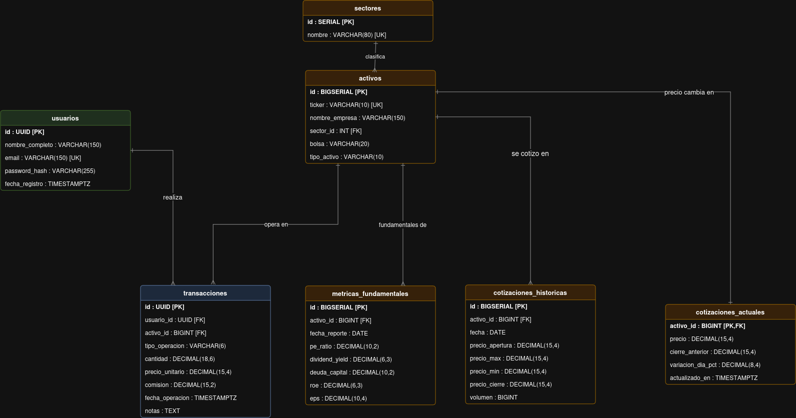

# ProgramacionWebTP
# TP2 y TP3 - GoFolio

**Dominio elegido:** GoFolio, una aplicación web y API REST para registrar transacciones y gestionar un portafolio de inversiones financieras.

## Entidades Principales del Dominio

Para representar el sistema, guardaremos la información estructurada en las siguientes entidades:

* **Usuarios:** Datos de la cuenta del inversor (ID, email, credenciales).
* **Activos:** Catálogo de instrumentos financieros operables (Ticker, nombre, tipo).
* **Sectores:** Clasificación de la industria para analizar la diversificación del portafolio (ej: Tecnología, Finanzas).
* **Transacciones:** Registro de compras y ventas (usuario, activo, cantidad, precio, fecha, tipo).
* **Cotizaciones Actuales:** Último precio de mercado conocido por cada activo.
* **Cotizaciones Históricas:** Serie de precios diarios (apertura, máximo, mínimo, cierre, volumen) para graficar rendimientos.
* **Métricas Fundamentales:** Datos financieros trimestrales de las empresas (P/E Ratio, Dividend Yield, ROE, EPS, Deuda/Capital) para análisis.



---

## Modelo de Datos (Persistencia - TP2)

La capa de persistencia está construida sobre **PostgreSQL 15** y se diseñó priorizando la integridad de los datos financieros y el rendimiento de lectura.

### 1. Esquema Relacional
* `usuario`: Entidad principal de autenticación y dueña de los portafolios.
* `sector` y `activo`: Tablas de catálogo estático. Un sector agrupa múltiples activos (Relación 1:N).
* `transaccion`: Tabla transaccional central. Vincula a un `usuario` con un `activo` (Relación N:M).
* `cotizacion_actual`, `cotizacion_historica` y `metrica_fundamental`: Tablas satélite de mercado, fuertemente ligadas a la entidad `activo` mediante Foreign Keys.

### 2. Decisiones de Diseño de Base de Datos
* **Tipos de Datos Financieros:** Se descartó el uso de coma flotante (`FLOAT`/`REAL`) por sus problemas de redondeo. En su lugar, se utilizó **`DECIMAL/NUMERIC`** (ej. `DECIMAL(15,4)`) para garantizar precisión absoluta en precios, comisiones y balances.
* **Identificadores (PKs) — Seguridad vs. Rendimiento:** 
  * Se implementó **`UUID`** (vía `pgcrypto`) para las tablas privadas/sensibles (`usuario` y `transaccion`). Esto previene vulnerabilidades **IDOR (Insecure Direct Object Reference)** y ataques de enumeración en las URLs de la API, además de ocultar métricas de volumen de negocio.
  * Se utilizaron secuencias enteras (`BIGSERIAL` y `SERIAL`) para entidades públicas y altamente relacionales (`activo`, `sector`, `cotizacion_historica`, `metrica_fundamental`), optimizando el uso de memoria y la velocidad de los índices B-Tree en los `JOINs`.
* **Integridad y Restricciones:** 
  * Uso de `ON DELETE CASCADE` para limpiar historiales si se elimina un activo.
  * Uso de `ON DELETE RESTRICT` en transacciones: es imposible eliminar un activo de la base de datos si ya existen usuarios que operaron con él.
  * Restricciones `CHECK` a nivel motor para evitar estados inválidos (ej: `tipo_operacion IN ('compra', 'venta')`).
* **Índices Estratégicos:** Se crearon índices B-Tree (`CREATE INDEX`) explícitos en todas las claves foráneas (ej: `usuario_id`, `activo_id`) para optimizar las consultas.

### 3. Generación de Capa de Acceso a Datos
Para la interacción con la base de datos se implementó **`sqlc`**, el cual compila los archivos `queries.sql` y `schema.sql` para generar código Go tipado. Se respetan convenciones estrictas de operaciones CRUD (`:one`, `:many`, `:exec`), incluyendo el uso de cláusulas `ON CONFLICT DO UPDATE` (Upsert) para sincronizaciones eficientes de precios en `cotizacion_actual`.

---

## Arquitectura de la API REST (Exponiendo la Lógica - TP3)

Para exponer la capa de datos a través de HTTP se diseñó una arquitectura limpia separada en capas, utilizando el paquete estándar `net/http` de Go e inyección de dependencias manual en `cmd/api/main.go`.

### 1. Decisiones de Diseño y Arquitectura en Go
* **Patrón Handler → Service → Repository (`sqlc`):**
  * **Handlers (`internal/handlers`):** Se encargan exclusivamente del transporte HTTP: lectura de parámetros de URL (`strconv.Atoi` o `uuid.Parse`), decodificación de JSON mediante **DTOs (Data Transfer Objects)** específicos para creación y actualización, y escritura de encabezados y códigos de estado HTTP.
  * **Services (`internal/services`):** Contienen toda la lógica de negocio, sanitización de strings (`TrimSpace`, `ToUpper`/`ToLower`), validaciones financieras y traducción de tipos opcionales a estructuras `sql.Null*`.
* **Mapeo Estricto de Errores y Códigos HTTP:**
  * Se definieron errores de dominio personalizados (`ErrValidacion` y `Err...NoEncontrado`).
  * Los servicios interceptan errores nativos del driver de PostgreSQL (`pq.Error`) como `23505` (*unique_violation*), `23503` (*foreign_key_violation*) y `22003` (*numeric_value_out_of_range*), transformándolos en errores de validación claros para que el Handler responda `400 Bad Request` en lugar de exponer errores internos (`500`).
  * Las búsquedas sin resultados (`sql.ErrNoRows`) se traducen en respuestas `404 Not Found` tanto en `GET` como en `PUT` y `DELETE`.
* **Reglas de Negocio y Seguridad:**
  * **Hashing de Contraseñas:** Las contraseñas en `UsuarioService` nunca se almacenan en texto plano; se encriptan utilizando **`bcrypt`** (costo 10) antes de persistirse.
  * **Coherencia Financiera (OHLC):** En `CotizacionHistoricaService` se valida matemáticamente que la vela diaria sea coherente (`precio_min <= precio_max` y que tanto `precio_apertura` como `precio_cierre` se encuentren dentro del rango `[min, max]`).
  * **Aislamiento de Transacciones:** Todas las operaciones sobre transacciones exigen la validación conjunta de `id` y `usuario_id`, garantizando que un usuario solo pueda consultar, modificar o eliminar sus propias operaciones.
  * **Serialización de Listas Vacías:** Todos los métodos `Listar` inicializan un slice vacío (`[]T{}`) cuando no existen registros en la base de datos, garantizando que la API devuelva siempre un array JSON válido (`[]`) en lugar de `null`.
* **Middleware de Observabilidad (`internal/middleware`):**
  * Se implementó un middleware `Logging` global que intercepta cada petición HTTP y registra en consola el método, la ruta solicitada, la dirección IP del cliente y el tiempo exacto de ejecución en microsegundos/milisegundos.

### 2. Endpoints Disponibles

| Recurso | Colección (`GET`, `POST`) | Recurso Individual (`GET`, `PUT`, `DELETE`) | Notas de Uso |
| :--- | :--- | :--- | :--- |
| **Healthcheck** | `GET /ping` | — | Verifica el estado del servidor (`200 OK`). |
| **Sectores** | `/sectores` | `/sectores/{id}` | `id` numérico (`SERIAL`). |
| **Activos** | `/activos` | `/activos/{id}` | `id` numérico (`BIGSERIAL`). |
| **Cotizaciones Actuales** | `/cotizaciones-actuales` | `/cotizaciones-actuales/{activo_id}` | Implementa *Upsert* por `activo_id`. |
| **Cotizaciones Históricas** | `/cotizaciones-historicas?activo_id={id}` | `/cotizaciones-historicas/{id}` | Listado requiere query param `activo_id`. |
| **Métricas Fundamentales** | `/metricas-fundamentales?activo_id={id}` | `/metricas-fundamentales/{id}` | Listado requiere query param `activo_id`. |
| **Usuarios** | `/usuarios` | `/usuarios/{uuid}` | Identificador `UUID`. |
| **Transacciones** | `/transacciones?usuario_id={uuid}` | `/transacciones/{uuid}?usuario_id={uuid}` | Requiere `usuario_id` por seguridad. |

---

## Cómo ejecutar el proyecto y las pruebas automatizadas

El proyecto cuenta con un flujo **100% automatizado** (`Makefile` + `test.sh`) que se encarga de:
1. Ejecutar `sqlc generate`, sincronizar dependencias (`go mod tidy`) y compilar el servidor Go (`./bin/api`).
2. Borrar contenedores y volúmenes previos de Docker (`docker compose down -v`) para garantizar un entorno limpio.
3. Levantar el contenedor de PostgreSQL e inyectar el esquema inicial (`schema.sql`).
4. Esperar a que la base de datos responda mediante `pg_isready` y levantar el servidor de la API en segundo plano.
5. Ejecutar los tests unitarios de la capa de datos (`go test ./...`) y la suite de pruebas de integración de la API con **Hurl** (`requests.hurl`, 47 peticiones cubriendo todo el ciclo CRUD y casos de error).
6. Detener el proceso del servidor Go, eliminar binarios temporales y destruir los contenedores y volúmenes de Docker al finalizar (mediante `trap cleanup EXIT`).

### Requisitos previos
* Tener **`Docker`** y **`Docker Compose`** instalados.
* Tener **`Go`** (1.22+) instalado localmente.
* Tener **`sqlc`** y **`curl`** instalados.
* Tener **`Hurl`** instalado para las pruebas de la API:
  * *En Ubuntu/Debian:* Descargar el paquete `.deb` desde [Hurl Releases](https://github.com/Orange-OpenSource/hurl/releases) o vía `cargo install hurl`.
  * *En macOS:* `brew install hurl`
  * *En Arch Linux:* `pacman -S hurl`

### Ejecución automatizada de los tests 

Clonar el repositorio apuntando a la rama **`tp3`** y ejecutar el comando de prueba:

```bash
git clone -b tp3 --single-branch https://github.com/FranRamallo/ProgramacionWebTP.git 
cd ProgramacionWebTP/TP3_DB
make test-api
