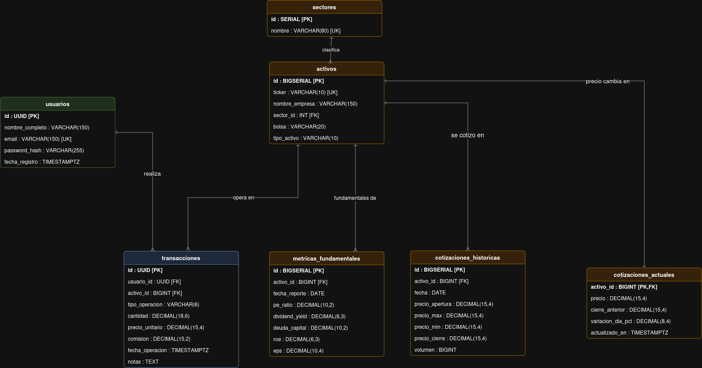
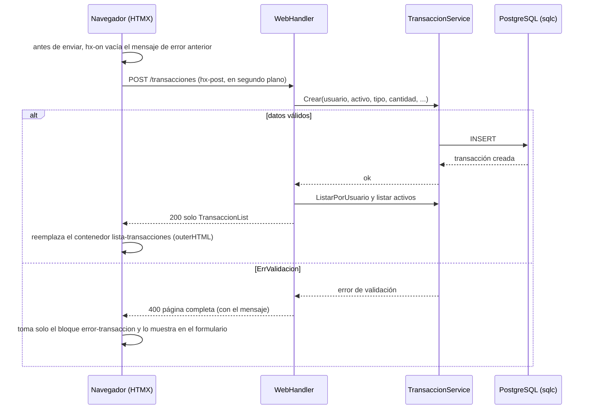
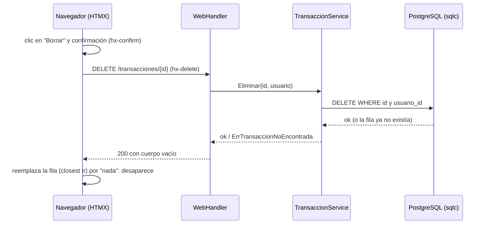

# GoFolio — Documentación del proyecto

Documentación completa de GoFolio en su versión final (TP6). Para ejecutar la aplicación, ver el [README.md](../README.md).

**Contenido:** [Qué hace](#qué-hace-la-aplicación-tp6) · [Entidades](#entidades-principales-del-dominio) · [HTMX](#cómo-funciona-htmx-sobre-vistas-del-servidor) · [Arquitectura](#arquitectura) · [Decisiones de diseño](#decisiones-de-diseño-tp6) · [Modelo de datos](#modelo-de-datos-persistencia---tp2) · [Capa de servicios](#capa-de-servicios-tp3-vigente-en-el-tp6) · [Ejecución y pruebas](#ejecución-y-pruebas) · [Notas técnicas](#notas-técnicas-de-htmx-4) · [Limitaciones](#notas-y-limitaciones)

---

## Qué hace la aplicación (TP6)

Una página única donde el usuario administra las operaciones (compras y ventas) de su portafolio:

* **Historial de operaciones:** fecha, activo, tipo, cantidad, precio, comisión y notas.
* **Registrar una operación:** formulario con activo, tipo, cantidad, precio, comisión y notas opcionales. Al enviarlo, la lista se actualiza sola, **sin recargar la página**. Si los datos no son válidos, aparece el mensaje de error debajo del formulario y la lista no cambia.
* **Borrar una operación** desde el historial: el botón pide confirmación y la fila desaparece sin recargar. Si era la última, aparece el mensaje "Todavía no registraste ninguna operación".

El servidor sigue generando el HTML con **templ** (TP5) y los estilos usan **Pico.css**. La novedad es **HTMX**, una librería que se carga por CDN: en vez de navegar a otra página, el navegador pide el HTML en segundo plano y reemplaza solo la parte que cambió. No hay archivos JavaScript: la interactividad se declara con atributos `hx-*` en el HTML (la única línea de código del lado del cliente es una expresión corta en `hx-on` que vacía el mensaje de error; ver [Decisiones de diseño](#decisiones-de-diseño-tp6)) y **el repositorio no contiene archivos `.js`**.

---

## Entidades principales del dominio

* **Usuarios:** Datos de la cuenta del inversor (ID, email, credenciales).
* **Activos:** Catálogo de instrumentos financieros operables (Ticker, nombre, tipo).
* **Sectores:** Clasificación de la industria para analizar la diversificación del portafolio (ej: Tecnología, Finanzas).
* **Transacciones:** Registro de compras y ventas (usuario, activo, cantidad, precio, fecha, tipo).
* **Cotizaciones Actuales:** Último precio de mercado conocido por cada activo.
* **Cotizaciones Históricas:** Serie de precios diarios (apertura, máximo, mínimo, cierre, volumen) para graficar rendimientos.
* **Métricas Fundamentales:** Datos financieros trimestrales de las empresas (P/E Ratio, Dividend Yield, ROE, EPS, Deuda/Capital) para análisis.



> En el TP6 la interfaz trabaja con la entidad **Transacciones** (listar, registrar y borrar); el resto del
> modelo sigue disponible en la base y en los servicios.

---

## Cómo funciona (HTMX sobre vistas del servidor)

### Un ejemplo primero

Estas son las dos únicas piezas de HTMX que usa la aplicación (están en `views/`):

```html
<!-- Formulario de alta -->
<form hx-post="/transacciones"
      hx-target="#lista-transacciones"
      hx-swap="outerHTML"
      hx-status:400="target:#error-transaccion select:#error-transaccion swap:outerHTML"
      hx-on::before:request="this.querySelector('#error-transaccion').innerHTML = ''">

<!-- Botón de cada fila -->
<button hx-delete="/transacciones/{id}"
        hx-target="closest tr"
        hx-swap="outerHTML"
        hx-confirm="¿Borrar esta operación?">Borrar</button>
```

| Atributo | Qué le dice a HTMX |
|---|---|
| `hx-post` / `hx-delete` | Hacer esa petición HTTP en segundo plano, en vez de navegar a otra página |
| `hx-target` | Dónde poner la respuesta: el elemento con id `lista-transacciones`, o `closest tr` (la fila donde está el botón) |
| `hx-swap="outerHTML"` | Reemplazar el elemento entero por la respuesta. Si la respuesta está vacía, el elemento desaparece |
| `hx-confirm` | Preguntar antes de enviar (diálogo del navegador) |
| `hx-status:400` | Si el servidor responde `400`, tomar de la respuesta solo el bloque `#error-transaccion` y ponerlo en el formulario (la lista no se toca) |
| `hx-on::before:request` | Antes de enviar el formulario ejecuta una expresión corta que vacía el mensaje de error anterior (así un error viejo no queda visible junto a una operación que sí se registró) |

### Rutas

| Método | Ruta | Qué hace | Respuesta |
|---|---|---|---|
| `GET` | `/` | Página completa: formulario + historial | `200` HTML |
| `POST` | `/transacciones` | Registra una operación (lo envía HTMX) | `200` con **solo** la lista actualizada (`TransaccionList`, sin `<html>`); `400` con la página completa y el mensaje de error; `500` |
| `DELETE` | `/transacciones/{id}` | Borra una operación | `200` con el **cuerpo vacío**; `400` si el id no es un UUID; `500` |
| `GET` | `/static/…` | Archivos estáticos (`styles.css`) | CSS |
| `GET` | `/ping` | Chequeo de salud | `ok` |

Cualquier otra ruta responde `404`, y un método no permitido sobre una ruta existente, `405` (lo resuelve
`http.ServeMux` de Go ≥ 1.22 con patrones `"MÉTODO /ruta"`; el `{id}` se lee con `r.PathValue("id")`).

### Flujo de alta

El handler ya no redirige: vuelve a consultar la lista completa y responde solo con ese componente.
HTMX lo coloca en `#lista-transacciones`.



### Flujo de borrado



Dos detalles importantes:

* **La respuesta del borrado es `200` y no `204`:** con `204 No Content` HTMX no intercambia nada y la fila quedaría en pantalla.
* **El borrado no vuelve a pedir la lista:** solo se saca la fila del DOM. Es más eficiente que redibujar toda la tabla.

### Lista vacía sin pedirle nada al servidor

La tabla se dibuja siempre. Al final del `<tbody>` hay una fila oculta con el mensaje (`<tr class="vacio">`) y el CSS la muestra
**solo cuando es la única fila**:

```css
tr.vacio { display: none; }
tr.vacio:only-child { display: table-row; }
```

Así, al borrar la última operación el mensaje aparece solo, sin una petición extra y sin lógica en el servidor.

---

## Arquitectura

Se mantiene el modelo de **3 capas**: `handlers → services → sqlc → PostgreSQL`.

| Capa | Dónde | Responsabilidad | Qué NO hace |
|---|---|---|---|
| Presentación | `views/` (templ), `internal/handlers/`, rutas en `cmd/api/main.go` | Recibir el request, parsear el formulario, pedir datos a los servicios, elegir el status HTTP (200/400/500) y dibujar el HTML o el fragmento | Reglas de negocio ni SQL |
| Lógica de negocio | `internal/services/` | Validaciones de dominio (tipo `compra`/`venta`, cantidad > 0, montos, notas, FK inexistente), limpieza de datos, traducción de errores de PostgreSQL | Saber qué es un request HTTP ni escribir SQL |
| Datos | `db/queries/queries.sql` → `sqlc` → `db/sqlc/` | Ejecutar consultas y mapear filas a structs Go | Tomar decisiones de negocio |

Igual que en el TP5, en el TP6 solo cambió la capa de presentación: los servicios y el acceso a datos no se tocaron.
El handler cambió su forma de responder (fragmentos en vez de redirecciones) y se sumó la ruta `DELETE`.

### Vistas templ

| Componente | Archivo | Recibe | Dibuja |
|---|---|---|---|
| `Layout(titulo)` | `layout.templ` | título + `{ children... }` | `<html>`, `<head>` (Pico.css, `styles.css` y el script de HTMX por CDN con SRI), `<body>` |
| `TransaccionForm(activos, valores, error)` | `transaccion_form.templ` | activos, valores escritos, mensaje | Formulario con `hx-post` y el bloque `#error-transaccion` donde se muestra el error |
| `TransaccionList(transacciones, activos)` | `transaccion_list.templ` | transacciones + activos (para mostrar el ticker) | `<article id="lista-transacciones">` (destino de HTMX) con la tabla, un botón `hx-delete` por fila y la fila oculta `.vacio` |
| `IndexPage(datos)` | `index.templ` | `IndexData` | `Layout` + formulario + lista |

`templ generate` convierte cada `.templ` en `*_templ.go` (Go normal, tipado y con escape automático de
HTML). El binario final no necesita templ instalado.

### Handlers (`internal/handlers/web_handler.go`)

| Método | Qué hace |
|---|---|
| `Index` | `GET /`: página completa con el formulario vacío |
| `Crear` | `POST /transacciones`: valida el formato, llama al servicio y, si salió bien, responde con `renderLista`; si hay un error de validación, `renderIndex` con status `400` |
| `Eliminar` | `DELETE /transacciones/{id}`: toma el id de la URL, llama al servicio y responde `200` vacío |
| `renderIndex` | Junta los datos y dibuja la página completa con el status indicado |
| `renderLista` | Vuelve a consultar la lista y responde **solo** con `TransaccionList` |

### Estructura del repositorio

```
.
├── Makefile                         # reenvía run-app / test / generate a TP5_WEB/
├── README.md                        # cómo ejecutar
├── docs/
│   └── DOCUMENTACION.md             # este documento
└── TP5_WEB/
    ├── cmd/api/main.go              # arma dependencias y rutas, levanta el servidor
    ├── views/                       # presentación (templ)
    │   ├── layout.templ             # <html>, <head> con Pico.css y HTMX, <body>
    │   ├── transaccion_form.templ   # formulario de alta (hx-post)
    │   ├── transaccion_list.templ   # tabla con el historial (hx-delete por fila)
    │   ├── index.templ              # IndexPage: layout + formulario + lista
    │   └── helpers.go               # formateo de fechas y decimales (solo presentación)
    ├── internal/
    │   ├── handlers/web_handler.go  # Index, Crear, Eliminar (HTTP ↔ servicios)
    │   ├── services/                # lógica de negocio por entidad
    │   └── middleware/              # logging de requests
    ├── db/
    │   ├── schema/schema.sql        # tablas
    │   ├── seed/seed.sql            # datos de ejemplo (usuario demo, activos, operaciones)
    │   ├── queries/queries.sql      # consultas SQL (entrada de sqlc)
    │   └── sqlc/                    # código generado por sqlc (no se versiona) + db_test.go
    ├── static/styles.css            # estilos propios (se cargan después de Pico.css)
    ├── web.hurl                     # pruebas HTTP de las páginas
    ├── docker-compose.yml           # PostgreSQL 15
    ├── run-app.sh · test.sh · Makefile
    └── sqlc.yaml
```

---

## Decisiones de diseño (TP6)

* **HTMX por CDN, sin archivos `.js`.** El script se carga desde `cdn.jsdelivr.net` con versión fija (`4.0.0`) y verificación de integridad (`integrity` SRI). Así el repositorio no tiene ningún `.js` y la interactividad queda declarada en el HTML.
* **El servidor devuelve fragmentos de HTML, no JSON.** Es la idea de HTMX: el servidor sigue siendo el dueño de la presentación (templ) y el navegador solo reemplaza partes de la página.
* **`hx-swap="outerHTML"` sobre `#lista-transacciones`** (y no `beforeend`): después de un alta el servidor vuelve a consultar y devuelve la lista completa, ya ordenada. Así la pantalla nunca queda distinta de lo que hay en la base.
* **Un `400` no reemplaza la lista.** En HTMX 4, por defecto solo `204` y `304` no se intercambian, así que un `400` pondría la página entera dentro de `#lista-transacciones`. Con `hx-status:400` se le indica que tome solo `#error-transaccion` de la respuesta. El handler reutiliza `renderIndex` para el error, sin una vista extra.
* **El mensaje de error se limpia antes de cada envío.** El formulario tiene `hx-on::before:request="this.querySelector('#error-transaccion').innerHTML = ''"`: una expresión corta (la única línea de código del lado del cliente de la aplicación) que vacía el bloque del error. Así un error viejo no queda visible junto a una operación que sí se registró. Existe una alternativa sin código cliente: que el servidor incluya en la respuesta del alta un fragmento `<div id="error-transaccion" hx-swap-oob="true"></div>` ("out of band"); se probó y funciona, pero se mantuvo `hx-on` porque es más directo y no requiere tocar el servidor.
* **Borrado con `DELETE` real.** En el TP5 el borrado era un `POST` con el `id` en un campo oculto, porque un formulario HTML solo sabe enviar `GET` o `POST`. HTMX usa `fetch`, que sí puede enviar `DELETE`, así que ahora la ruta es REST: `DELETE /transacciones/{id}`.
* **Borrado tolerante:** si la operación ya no existe (doble clic o pestaña desactualizada) igual se responde `200`, para que la fila desaparezca. El `DELETE` filtra por `id` **y** `usuario_id`, así que un usuario nunca puede borrar operaciones ajenas.
* **La tabla se dibuja siempre y el mensaje de "lista vacía" lo muestra el CSS** (ver arriba). Evita volver a pedir la lista al borrar y no agrega lógica al servidor.
* **Sin redirección tras el alta:** se elimina el Post/Redirect/Get del TP5, porque ya no hay navegación: HTMX recibe el fragmento y lo coloca.

### Decisiones que se mantienen del TP5

* **Un handler por pantalla, un servicio por entidad.** `WebHandler` combina los servicios que necesita la página principal (transacciones y activos); cada servicio mantiene la lógica de una sola entidad.
* **Validación en el borde, una sola vez.** El handler valida el *formato* (que el activo sea un número, que el `id` sea un UUID) y el servicio valida las *reglas de negocio* (cantidad mayor a 0, tipo permitido, activo existente, largo de las notas).
* **Errores inesperados:** se registran en el log y responden `500` sin mostrar detalles internos.
* **Notas opcionales, máximo 200 caracteres.** La columna `notas` es `TEXT` (sin tope), así que el límite se valida en el servicio (el `maxlength` del formulario es solo comodidad). En el historial se muestran en una línea bajo el ticker, cortadas con "…" y completas al pasar el mouse (`title`).
* **Usuario demo fijo:** sin login, `main.go` le pasa al handler el `usuarioID` del usuario creado por `db/seed/seed.sql`. Cuando se implementen sesiones se reemplaza por el usuario autenticado y habrá que agregar protección CSRF.
* **Pico.css por CDN** (versión fija `2.1.1`) + `static/styles.css` para el layout de dos columnas, los colores de compra/venta y el botón compacto de borrado.
* **Seed en el arranque de la BD:** `docker-compose.yml` monta `01-schema.sql` y `02-seed.sql` en `docker-entrypoint-initdb.d` (Postgres los corre en orden, solo con el volumen vacío; por eso `run-app.sh` borra el volumen antes de levantar). El `healthcheck` usa `pg_isready -h 127.0.0.1` (TCP) para no declarar "listo" antes de que la base acepte conexiones de la app.
* **Código generado fuera del repositorio:** `db/sqlc/*.go` y `views/*_templ.go` están en `.gitignore` y los produce `run-app.sh` en cada ejecución. Los tests de `db/sqlc` (`*_test.go`) sí se versionan.
* **Herramientas fijadas en `go.mod`:** `templ` se ejecuta con `go tool templ`, así la versión del generador coincide siempre con la de la librería que usa el código generado. `sqlc` usa la versión instalada o, si no hay, `go run` con una versión fija.

### Cambios respecto del TP5

| Antes (TP5) | Ahora (TP6) |
|---|---|
| Formularios HTML clásicos: cada acción recarga la página | HTMX: cada acción pide HTML en segundo plano y reemplaza solo lo que cambió |
| `POST /transacciones` → `303` → `GET /` (Post/Redirect/Get) | `POST /transacciones` → `200` con solo la lista actualizada |
| `POST /transacciones/eliminar` con el `id` en un campo oculto | `DELETE /transacciones/{id}` → `200` con cuerpo vacío |
| Error de validación: página completa con `400` | Igual, pero HTMX toma solo el bloque del error (`hx-status:400`) |
| "Lista vacía" decidida por el servidor (`<p>` condicional) | Tabla siempre presente + fila `.vacio` que muestra el CSS |
| Sin JavaScript | Sin archivos `.js`: HTMX por CDN y una expresión `hx-on` |
| `web.hurl`: respuestas `303` y `POST` de borrado | `web.hurl`: `200` con fragmento y `DELETE` |

---

## Modelo de datos (Persistencia - TP2)

La capa de persistencia está construida sobre **PostgreSQL 15** y se diseñó priorizando la integridad de los datos financieros y el rendimiento de lectura.

### 1. Esquema relacional
* `usuario`: Entidad principal de autenticación y dueña de los portafolios.
* `sector` y `activo`: Tablas de catálogo estático. Un sector agrupa múltiples activos (Relación 1:N).
* `transaccion`: Tabla transaccional central. Vincula a un `usuario` con un `activo` (Relación N:M).
* `cotizacion_actual`, `cotizacion_historica` y `metrica_fundamental`: Tablas satélite de mercado, fuertemente ligadas a la entidad `activo` mediante Foreign Keys.

### 2. Decisiones de diseño de base de datos
* **Tipos de datos financieros:** Se descartó el uso de coma flotante (`FLOAT`/`REAL`) por sus problemas de redondeo. En su lugar, se utilizó **`DECIMAL/NUMERIC`** (ej. `DECIMAL(15,4)`) para garantizar precisión absoluta en precios, comisiones y balances.
* **Identificadores (PKs) — seguridad vs. rendimiento:**
  * Se implementó **`UUID`** (vía `pgcrypto`) para las tablas privadas/sensibles (`usuario` y `transaccion`). Esto previene vulnerabilidades **IDOR (Insecure Direct Object Reference)** y ataques de enumeración en las URLs, además de ocultar métricas de volumen de negocio.
  * Se utilizaron secuencias enteras (`BIGSERIAL` y `SERIAL`) para entidades públicas y altamente relacionales (`activo`, `sector`, `cotizacion_historica`, `metrica_fundamental`), optimizando el uso de memoria y la velocidad de los índices B-Tree en los `JOINs`.
* **Integridad y restricciones:**
  * Uso de `ON DELETE CASCADE` para limpiar historiales si se elimina un activo.
  * Uso de `ON DELETE RESTRICT` en transacciones: es imposible eliminar un activo de la base de datos si ya existen usuarios que operaron con él.
  * Restricciones `CHECK` a nivel motor para evitar estados inválidos (ej: `tipo_operacion IN ('compra', 'venta')`).
* **Índices estratégicos:** Se crearon índices B-Tree (`CREATE INDEX`) explícitos en todas las claves foráneas (ej: `usuario_id`, `activo_id`) para optimizar las consultas.

### 3. Generación de la capa de acceso a datos
Para la interacción con la base de datos se implementó **`sqlc`**, el cual compila los archivos `queries.sql` y `schema.sql` para generar código Go tipado. Se respetan convenciones estrictas de operaciones CRUD (`:one`, `:many`, `:exec`), incluyendo el uso de cláusulas `ON CONFLICT DO UPDATE` (Upsert) para sincronizaciones eficientes de precios en `cotizacion_actual`.

## Capa de servicios (TP3, vigente en el TP6)

La API REST JSON del TP3 sigue disponible en la rama `tp3`. Desde el TP5 se reemplazó por las vistas, pero
las reglas de negocio de `internal/services` se mantienen:

* **Validación y errores de dominio:** `ErrValidacion` y `Err...NoEncontrado`. Los servicios interceptan errores del driver de PostgreSQL (`pq.Error`) como `23505` (*unique_violation*), `23503` (*foreign_key_violation*) y `22003` (*numeric_value_out_of_range*) y los convierten en errores de validación claros. El handler los traduce a `400` (volviendo a mostrar el formulario con el mensaje) en lugar de exponer errores internos (`500`).
* **Sanitización:** `TrimSpace`, `ToUpper`/`ToLower` y traducción de campos opcionales a `sql.Null*`.
* **Hashing de contraseñas:** en `UsuarioService` nunca se guardan en texto plano; se encriptan con **`bcrypt`** (costo 10).
* **Coherencia financiera (OHLC):** `CotizacionHistoricaService` valida que `precio_min <= precio_max` y que apertura y cierre estén dentro de `[min, max]`.
* **Aislamiento de transacciones:** las operaciones sobre transacciones exigen `id` y `usuario_id` a la vez, así un usuario solo puede consultar o borrar las suyas.
* **Middleware de observabilidad (`internal/middleware`):** `Logging` registra método, ruta, IP y tiempo de cada request.

---

## Ejecución y pruebas

Resumen de cómo ejecutar: ver [README.md](../README.md). Acá el detalle de los scripts y las pruebas.

### Qué hace `run-app.sh`

| Fase | Pasos |
|---|---|
| **1. Tareas previas** | `templ generate` (vistas) → `sqlc generate` (acceso a datos; si `sqlc` no está instalado se ejecuta con `go run`) → compilar a `bin/gofolio` → borrar contenedores y volúmenes viejos → `docker compose up -d --wait` (levanta PostgreSQL y espera a que esté listo) |
| **2. Ejecución** | Inicia la aplicación en primer plano |
| **3. Tareas posteriores** | Siempre al salir (`Ctrl+C`, error o `kill`): detiene la app, borra `bin/` y ejecuta `docker compose down -v` (contenedores y volúmenes) |

La base se crea desde cero en cada ejecución con `db/schema/schema.sql` y los datos de ejemplo de
`db/seed/seed.sql` (5 activos y 5 operaciones de un usuario demo), así que el historial nunca arranca vacío.

El código generado (`db/sqlc/*.go` y `views/*_templ.go`) **no se sube al repositorio**: lo produce
`run-app.sh` en cada ejecución. En un clon recién hecho, el editor marca errores en esas carpetas hasta
correr `make run-app` o `make generate`.

### Configuración (opcional)

Sin configurar nada funciona. Para cambiar un valor, exportalo antes de ejecutar
(por ejemplo `DB_PORT=5433 make run-app`):

| Variable | Por defecto | Uso |
|---|---|---|
| `DB_USER` / `DB_PASSWORD` / `DB_NAME` | `postgres` / `postgres` / `apirest` | Credenciales de PostgreSQL |
| `DB_HOST` / `DB_PORT` | `localhost` / `7777` | Dónde escucha PostgreSQL (puerto publicado por Docker) |
| `PORT` | `8080` | Puerto HTTP de la aplicación |

### Otros comandos

| Comando | Qué hace |
|---|---|
| `make generate` | Regenera las vistas (`templ`) y el código de `sqlc` |
| `make test` | Pruebas HTTP de las páginas (Hurl) + tests de la base de datos (ver [Pruebas](#pruebas)) |
| `make db-up` / `make db-down` | Levanta / elimina solo la base de datos (para desarrollar con `go run ./cmd/api`). Se usan desde `TP5_WEB/` |

### Pruebas

```bash
make test
```

Hace lo mismo que `run-app.sh` (generar, compilar, base nueva, app en segundo plano) y ejecuta:

* **`web.hurl`:** 13 peticiones HTTP contra las páginas: principal con los datos del seed (5 filas y 5 botones `hx-delete`), archivos estáticos, `404`, alta válida (`200` con **solo** el fragmento de la lista: sin `<html>`, un único `#lista-transacciones` y 6 filas), validaciones `400` (cantidad inválida, activo inválido), borrado con `DELETE` (`200` y cuerpo vacío; el doble borrado también responde `200`; id inválido `400`), la fila desaparece del historial y `405`.
* **`go test -count=1 ./...`:** los tests de la capa de datos (`db/sqlc`), que ejecutan el CRUD de las 7 entidades. `-count=1` desactiva la caché de Go, porque los resultados dependen de la base. Estos tests se conectan siempre a `localhost:7777` con las credenciales por defecto.

Al terminar limpia todo (app, `bin/`, contenedores y volúmenes), aunque algo falle.
Requiere [Hurl](https://hurl.dev): `brew install hurl` (macOS), `pacman -S hurl` (Arch), o el paquete
`.deb` desde [Hurl Releases](https://github.com/Orange-OpenSource/hurl/releases) (Ubuntu/Debian).

El comportamiento en el navegador (que la página no se recargue, la confirmación, el mensaje de lista vacía) no lo cubre Hurl:
se verifica a mano con los pasos de [Probarlo a mano](#probarlo-a-mano).

### Probarlo a mano

1. Abrí `http://localhost:8080` y las herramientas de desarrollo del navegador (`F12`) en la pestaña **Network**.
2. Registrá una operación: aparece en la lista y en Network solo hay una petición `fetch` (`POST /transacciones`), sin pedido de documento ni recarga.
3. Probá con cantidad `0`: el mensaje de error aparece bajo el formulario y la lista no cambia.
4. Tocá **Borrar**, aceptá la confirmación: sale un `DELETE /transacciones/{id}` y la fila desaparece. Si borrás todas, aparece el mensaje de lista vacía.

---

## Notas técnicas de HTMX 4

Detalles comprobados en el navegador que conviene conocer si se sigue extendiendo la interfaz:

* **`hx-on::<evento>` ejecuta JavaScript inline.** `hx-on::before:request` es la forma corta de escuchar el evento `htmx:before:request`.
* **`204` no intercambia contenido.** Para "reemplazar por nada" (borrado) hay que responder `200` con cuerpo vacío.
* **Los `4xx`/`5xx` sí se intercambian** en HTMX 4 (solo `204` y `304` no). Por eso el `400` del alta necesita `hx-status:400`.
* **`hx-trigger="… changed"` solo mira el `.value` del elemento que tiene el trigger.** En un `<tr>` o un `<div>` no hay valor y nunca dispara; para escuchar inputs hijos alcanza con `hx-trigger="input delay:300ms"`.
* **`hx-include="this"`** sobre un contenedor incluye los campos con `name` de sus descendientes.
* **El CSS lo sirve `http.FileServer` sin `Cache-Control`:** el navegador lo cachea y un F5 común no lo revalida (usar `Ctrl+Shift+R` al cambiar estilos).

## Notas y limitaciones

- **Sin login todavía:** la aplicación opera siempre con el usuario demo del seed (`demo@gofolio.local`); autenticación y sesiones quedan para un TP posterior.
- **Solo la entidad Transacciones en la interfaz:** el resto de las entidades existe en la base y en los servicios, pero todavía no tiene pantalla.
- **HTMX y Pico.css por CDN:** la aplicación necesita internet (igual que Docker y los módulos de Go). Si HTMX no carga, la página se ve pero el formulario y los botones de borrar no hacen lo esperado: el formulario hace un `POST` común y el navegador muestra solo el fragmento de la lista.
- **Mejoras posibles:** filtros por columna en la cabecera del historial (con HTMX bastaría un `hx-get` que reemplace solo el `<tbody>`), edición de operaciones y pantallas para el resto de las entidades.